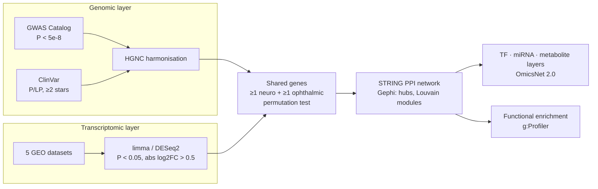

# Multi-omics network analysis of shared routes in retinal and neurodegenerative diseases

[](LICENSE)


Analysis code for the study **"Multi-Omics Network-Based Analysis of Common Routes in
Pathogenesis of Retinal and Neurodegenerative Diseases"**.

The study integrates genomic and transcriptomic evidence across two neurodegenerative
diseases — **Alzheimer's disease (AD)** and **Parkinson's disease (PD)** — and three
ophthalmic diseases — **age-related macular degeneration (AMD)**, **diabetic retinopathy
(DR)** and **glaucoma** — to identify genes, networks and pathways shared at the
retina–brain interface.

---

## Overview



| Step | What is done | Where |
|---|---|---|
| Genomic layer | Disease-associated loci from the GWAS Catalog and ClinVar, merged per disease and harmonised to HGNC symbols | `scripts/05`, `scripts/06` |
| Transcriptomic layer | Sample selection and differential expression in one disease-relevant tissue per disease | `scripts/01`–`scripts/02` |
| Shared genes | Genes present in ≥ 2 diseases including ≥ 1 neurodegenerative and ≥ 1 ophthalmic disease; size-matched permutation test (10,000 iterations) | `scripts/03`, `scripts/04`, `scripts/06` |
| Network, regulatory and enrichment analyses | STRING v12.5, Gephi 0.11.3, OmicsNet 2.0 (TRRUST, miRTarBase v9.0, KEGG), g:Profiler | Web tools (see Methods of the manuscript) |

### Transcriptomic datasets

| Disease | GEO | Platform | Tissue | Comparison | Cases | Controls |
|---|---|---|---|---|---:|---:|
| AD | [GSE48350](https://www.ncbi.nlm.nih.gov/geo/query/acc.cgi?acc=GSE48350) | Affymetrix HG-U133 Plus 2.0 | Hippocampus | AD vs non-demented controls (≥ 60 y) | 19 | 25 |
| PD | [GSE114517](https://www.ncbi.nlm.nih.gov/geo/query/acc.cgi?acc=GSE114517) | RNA-seq, NextSeq 500 | Substantia nigra | PD vs non-demented controls | 17 | 12 |
| AMD | [GSE115828](https://www.ncbi.nlm.nih.gov/geo/query/acc.cgi?acc=GSE115828) | RNA-seq, HiSeq 2500 | Retina (macula) | MGS4 vs MGS1 | 67 | 127 |
| DR | [GSE160306](https://www.ncbi.nlm.nih.gov/geo/query/acc.cgi?acc=GSE160306) | RNA-seq, HiSeq 4000 | Retina (macula) | NPDR + PDR vs healthy controls (donors) | 11 | 10 |
| Glaucoma | [GSE45570](https://www.ncbi.nlm.nih.gov/geo/query/acc.cgi?acc=GSE45570) | Affymetrix Human Exon 1.0 ST | Optic nerve head | POAG vs unaffected controls | 6 | 6 |

## Key findings

- **142** shared genomic entities (**96** protein-coding genes) and **52** shared
  transcriptomic DEGs, both well above chance (permutation *P* < 0.001);
  **SEMA3C** is common to both layers.
- The **147** shared protein-coding genes form a significantly enriched PPI network
  (65 connected proteins, 92 edges; PPI enrichment *P* = 5.95 × 10⁻¹⁹) with eight
  major Louvain modules (Q = 0.656).
- Hub genes: **APP, ITGB3, COL1A2, MMP2, FBLN1**.
- Regulatory annotation highlights **SP1** and **JUN** (TFs) and **miR-335-5p**,
  **miR-124-3p** and **miR-155-5p**; 93 endogenous metabolite interactions span sterol,
  retinoid, steroid hormone and eicosanoid pathways.
- Enrichment converges on **extracellular matrix organisation** and **retinoid/retinol
  metabolism**.

## Repository structure

```
.
├── scripts/
│   ├── 00_install.R                    # R/Bioconductor dependencies
│   ├── 01_metadata_explore.R           # download GEO series, parse sample metadata
│   ├── 02_DEG.R                        # sample selection, Table 4, differential expression
│   ├── 03_shared_genes.R               # DEG membership across diseases, Venn diagram
│   ├── 04_shared_neuro_ophth_2plus.R   # transcriptomic shared genes + direction of change
│   ├── 05_genomics_overlap.py          # exploratory genomic overlap and permutation test
│   └── 06_genomics_and_supp.py         # genomic shared genes, permutation test, figures, Tables S1–S5
├── data/                               # input data (not tracked, see data/README.md)
├── results/                            # generated outputs (not tracked)
├── run_pipeline.sh                     # runs the full pipeline
├── requirements.txt                    # Python dependencies
├── CITATION.cff                        # citation metadata
└── LICENSE
```

## Getting started

### Requirements

- **R ≥ 4.6** with Bioconductor 3.23 — GEOquery, limma, DESeq2, AnnotationDbi,
  org.Hs.eg.db, hgu133plus2.db, huex10sttranscriptcluster.db, ggVennDiagram, writexl
- **Python ≥ 3.10** — numpy, pandas, matplotlib, venn, openpyxl

```bash
git clone https://github.com/amirhossein-rajabi/retina-brain-multiomics.git
cd retina-brain-multiomics
Rscript scripts/00_install.R
python3 -m pip install -r requirements.txt
```

### Data

Download the input files and arrange them as described in
[`data/README.md`](data/README.md).

### Run

All scripts are run from the repository root.

```bash
bash run_pipeline.sh
```

or step by step:

```bash
Rscript scripts/01_metadata_explore.R GSE48350 GSE114517 GSE115828 GSE160306 GSE45570
Rscript scripts/02_DEG.R
PCOL=pvalue Rscript scripts/03_shared_genes.R
Rscript scripts/04_shared_neuro_ophth_2plus.R
python3 scripts/06_genomics_and_supp.py
```

`03_shared_genes.R` reads two environment variables: `LFC` (|log2FC| threshold,
default `0.5`) and `PCOL` (`padj` for FDR, the default, or `pvalue` for nominal *P*).
The manuscript uses nominal *P* < 0.05, because an FDR threshold yields no DEGs in
the glaucoma dataset.

### Outputs

| File | Content |
|---|---|
| `results/Table1_metadata.csv` | Dataset characteristics (manuscript Table 4) |
| `results/TableS1_samples.csv` | Included and excluded samples with reasons |
| `results/DEG/<disease>_all_genes.csv` | Full differential expression results |
| `results/all_DEG_membership_*.csv` | DEG membership and log2FC across diseases |
| `results/Shared_genes_neuro_ophthalmic_2plus.xlsx` | Transcriptomic shared genes with direction of change |
| `results/genomics/Supplementary_Tables.xlsx` | Supplementary Tables S1–S5 |
| `results/genomics/figs/` | Genomic and transcriptomic Venn diagrams (PNG, PDF) |
| `results/genomics/summary_numbers.json` | Counts and permutation results reported in the text |

## Methods in brief

**Genomic layer.** GWAS Catalog associations (P < 5 × 10⁻⁸; mapped genes) and ClinVar
records (pathogenic/likely pathogenic, ≥ 2 stars) were merged per disease and
harmonised to current HGNC symbols; entities matching an HGNC protein-coding locus
were classified as protein-coding genes.

**Transcriptomic layer.** Microarrays were log2-transformed when needed,
quantile-normalised and analysed with limma (highest-expressed probe per gene).
RNA-seq counts were filtered (≥ 10 counts in at least as many samples as the smaller
group) and analysed with DESeq2. DEGs: *P* < 0.05 and |log2FC| > 0.5.

**Shared genes and permutation test.** Shared genes are present in ≥ 2 diseases,
including at least one neurodegenerative and one ophthalmic disease. Significance was
assessed by drawing size-matched random gene sets (10,000 iterations; empirical
*P* = (r + 1)/(n + 1)).

## Software versions

R 4.6.1, Bioconductor 3.23, GEOquery 2.80.0, limma 3.68.5, DESeq2 1.52.0,
AnnotationDbi 1.74.0, org.Hs.eg.db 3.23.1, hgu133plus2.db 3.13.0,
huex10sttranscriptcluster.db 8.8.0; STRING v12.5; Gephi 0.11.3; OmicsNet 2.0;
g:Profiler e114_eg62_p19_9dc92ac8.

## Author

**Amir Hossein Rajabi** — [](https://orcid.org/0009-0004-1321-4187)

## Citation

If you use this code, please cite the associated article (full citation will be
added upon publication); citation metadata are also provided in
[`CITATION.cff`](CITATION.cff).

> Rajabi AH. Multi-Omics Network-Based Analysis of Common Routes in Pathogenesis of
> Retinal and Neurodegenerative Diseases. *Manuscript in preparation*, 2026.

## License

Released under the [MIT License](LICENSE).
